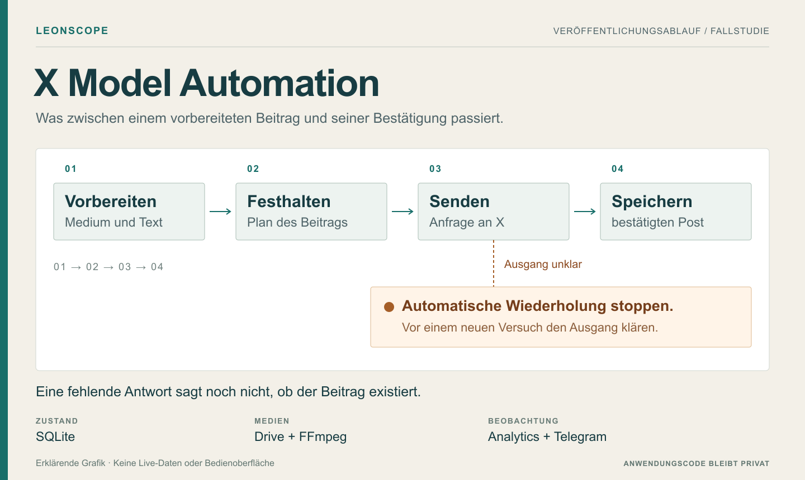

**Technische Fallstudie** · **Deutsch** / [English](README.md)

# X Model Automation

Neue Medien kommen über Google Drive ins System. Die Anwendung prüft sie, erstellt einen Textvorschlag und plant den Beitrag für X. Nach der Veröffentlichung speichert sie das Ergebnis, erfasst spätere Leistungsdaten und archiviert die verwendeten Medien.

Ich habe das Projekt mit KI-Unterstützung, unter anderem durch Codex, für den Betrieb von zwei Creator-Accounts entwickelt. Viel Arbeit steckte im Umgang mit Fehlern: Ein Prozess startet neu, eine API antwortet nicht eindeutig, ein Text wird mehrfach abgelehnt oder eine Datei lässt sich nach erfolgreichem Posting nicht verschieben.

**Dieses Repository stellt das Projekt vor. Anwendungscode, Konfiguration, Accountdaten und Medien bleiben privat.** Die Grafiken erklären den Ablauf; sie zeigen keine tatsächliche Bedienoberfläche. [Rechtehinweis](RIGHTS.md).

## Aktueller Stand

**Stand 19. Oktober 2026:** Die Bildautomation läuft für zwei Accounts. Die Video-Pipeline ist installiert; 103 Videos wurden eingelesen und normalisiert. Die KI-Auswertung der Videos ist noch nicht abgeschlossen. Ein echter Video-Testpost und die automatische Veröffentlichung geplanter Videos stehen noch aus. Auch vier wiederkehrende Fehler beim Einlesen sind noch offen.

Die [Status- und Prüfnotizen](docs/STATUS.de.md) unterscheiden diesen berichteten Betriebsstand von den früheren Testergebnissen. Für die Präsentation wurden weder das Produktivsystem aufgerufen noch neue Anwendungstests ausgeführt.

## Die wesentlichen Entwicklungsaufgaben

| Situation | Umgang im System |
| --- | --- |
| Eine Veröffentlichungsanfrage läuft in einen Timeout | Der unklare Ausgang bleibt zur Klärung gespeichert. Es wird nicht automatisch ein zweiter Beitrag gesendet. |
| Der Prozess startet neu | Veröffentlichungszustände und Wartezeiten werden aus SQLite wiederhergestellt. |
| Ein Text wiederholt eine frühere Formulierung | Die Prüfung berücksichtigt veröffentlichte Texte und bereits reservierte Texte für kommende Beiträge. |
| Das Archivieren in Drive scheitert nach dem Post | Der Veröffentlichungsnachweis bleibt in der Datenbank. Ein fehlgeschlagener Dateiumzug gibt das Medium nicht erneut frei. |
| Ein technischer Testpost erhält Interaktionen | Die Messwerte bleiben für die Diagnose erhalten und werden aus der geschäftlichen Auswertung ausgeschlossen. |
| Ein Video muss umgewandelt werden | Das Original bleibt erhalten. Die Upload-Version wird separat erstellt und über eine Prüfsumme zugeordnet. |

Die [Fallstudie](docs/CASE-STUDY.de.md) erklärt die Probleme und die Entscheidungen dahinter.

## Vom Medium zum Beitrag

Medienvorbereitung, Textprüfung, Planung und Veröffentlichung sind getrennte Schritte. Vor dem Senden werden Account, Medium, Text und Zeitpunkt gemeinsam festgehalten. Spätere Änderungen am Medienbestand verändern diesen vorbereiteten Beitrag nicht stillschweigend.

Bilder und Videos nutzen dieselbe Planung und Berichterstattung, brauchen aber unterschiedliche Vorbereitung. Bei Videos kommen Formatprüfung, gegebenenfalls eine Umwandlung und die Bewertung ausgewählter Einzelbilder hinzu. Vor dem Erstellen des Beitrags muss X die Verarbeitung des Uploads bestätigen. Die Prüfung ausgewählter Bilder ist keine Garantie für den gesamten Videoinhalt.

Telegram-Berichte zeigen unter anderem den Zustand der Dienste, den Vorrat vorbereiteter Inhalte und Fehler bei der Vorbereitung. Die Auswertung erfasst Beiträge nach **1 Stunde, 6 Stunden, 24 Stunden, 72 Stunden und 7 Tagen**. Sie unterstützt Entscheidungen, verändert aber nicht selbstständig die Postingstrategie.

[Zur Architektur](docs/ARCHITECTURE.de.md).

## Eingesetzte Technik

| Bereich | Werkzeuge |
| --- | --- |
| Anwendung | Python · Pydantic · SQLite · HTTPX |
| Medienverarbeitung | FFmpeg · ffprobe · Pillow · pillow-heif |
| Anbindungen | Google Drive API · OpenAI API · X API · Telegram Bot API |
| Betrieb | Windows-VPS · Windows-Aufgabenplanung · Virtuelle Python-Umgebung |

Für die Video-Erweiterung nennt der Projektbericht **844 bestandene lokale Tests** sowie **843 bestandene Tests und einen erwarteten plattformspezifischen Skip unter Windows**. Das sind berichtete frühere Ergebnisse, kein neuer Testlauf und kein öffentlicher CI-Nachweis. [Prüfumfang und offene Arbeiten](docs/STATUS.de.md).

## Was hier veröffentlicht ist

Öffentlich sind die Projektbeschreibung, die Architektur und ausgewählte Entwicklungsprobleme. Quellcode, Umgebungsvorlagen, Datenbanken, echte Beiträge, Originalmedien, interne Protokolle und Zugangsdaten gehören nicht zur Präsentation. Für das eigene Material wird keine Open-Source- oder Creative-Commons-Lizenz erteilt.

[Fallstudie](docs/CASE-STUDY.de.md) · [Architektur](docs/ARCHITECTURE.de.md) · [Status und Prüfungen](docs/STATUS.de.md) · [LeonScope](https://github.com/LeonScope)
