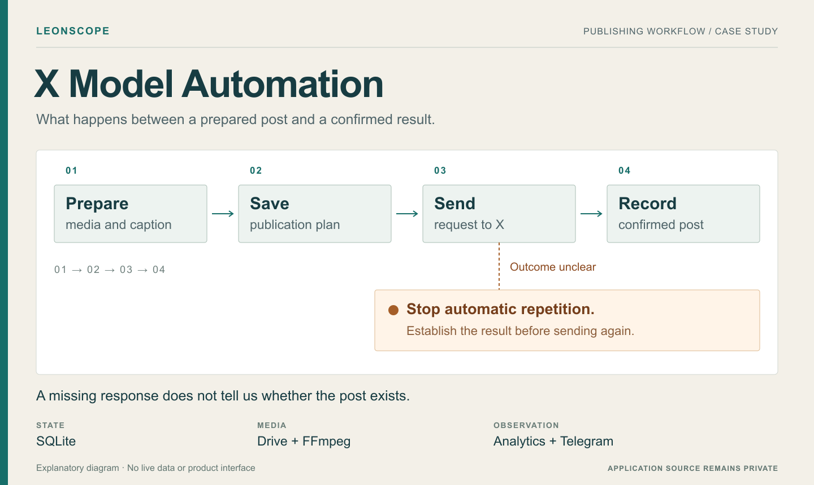

**Engineering case study** · **English** / [Deutsch](README.de.md)

# X Model Automation

Media arrives in Google Drive. The system checks it, prepares a caption and schedules a post for X. After publication, it records the result, collects performance observations and archives the media.

I developed this project with AI assistance, including Codex, for a workflow spanning two creator accounts. Much of the work went into handling failures: a process restart, an API response that never arrives, a caption rejected several times, or a file that cannot be moved after a successful post.

**This repository presents the project. The application source, configuration, account details and media remain private.** It contains explanatory graphics, not screenshots of a live dashboard. [Rights notice](RIGHTS.md).

## Current stage

**As of 19 October 2026:** image publishing is active for two accounts. The video pipeline is installed, and 103 videos have been ingested and normalized. Video analysis is not yet complete; a real video publication test and scheduled video posts are still pending. Four recurring ingestion errors also remain open.

The [status and validation notes](docs/STATUS.md) distinguish this reported operating stage from the historical test results. No production access or new application test run was used to prepare this presentation.

## Where the engineering work went

| Situation | How the system handles it |
| --- | --- |
| A publish request times out | Keeps the uncertain result for investigation instead of sending another post automatically. |
| The process restarts | Restores publication state and retry timing from SQLite. |
| A caption repeats an earlier phrase | Checks both published captions and wording reserved for future posts. |
| Archiving in Drive fails after publication | Retains the publication record in the database, so a failed file move does not make the media available again. |
| A technical test post receives engagement | Keeps its observations for diagnosis and excludes it from business performance reports. |
| A video needs conversion | Preserves the original and creates a separate upload version linked by a content hash. |

[Read the case study](docs/CASE-STUDY.md) for the reasoning behind these decisions.

## From media to publication

The workflow separates media preparation, caption review, planning and publication. Before a post is sent, the chosen account, media, text and time are saved together. Later changes to the content pool do not silently rewrite that prepared post.

Images and videos share planning and reporting, but use different preparation paths. Videos need format inspection, conversion where necessary, sampled-frame review and confirmation that X has finished processing the upload before a post can be created. Reviewing sampled frames does not prove that every frame is suitable.

Provider health, content reserves and preparation failures are included in Telegram reports. Analytics collect observations at five post ages: **1 hour, 6 hours, 24 hours, 72 hours and 7 days**. They inform decisions; they do not automatically change the posting strategy.

[See the architecture](docs/ARCHITECTURE.md).

## Technology

| Area | Tools |
| --- | --- |
| Application | Python · Pydantic · SQLite · HTTPX |
| Media | FFmpeg · ffprobe · Pillow · pillow-heif |
| Integrations | Google Drive API · OpenAI API · X API · Telegram Bot API |
| Operation | Windows VPS · Windows Task Scheduler · Python virtual environment |

The project report records **844 passing local tests**, and **843 passing tests plus one expected platform-specific skip on Windows** for the video extension. These are reported historical results, not a fresh test run or a public CI badge. [Details and remaining work](docs/STATUS.md).

## What is public

This presentation contains the project description, architecture and selected development problems. It does not include source code, environment templates, database files, real posts, original media, internal logs or credentials. No open-source or Creative Commons license is granted for the original material.

[Case study](docs/CASE-STUDY.md) · [Architecture](docs/ARCHITECTURE.md) · [Status and validation](docs/STATUS.md) · [LeonScope](https://github.com/LeonScope)
