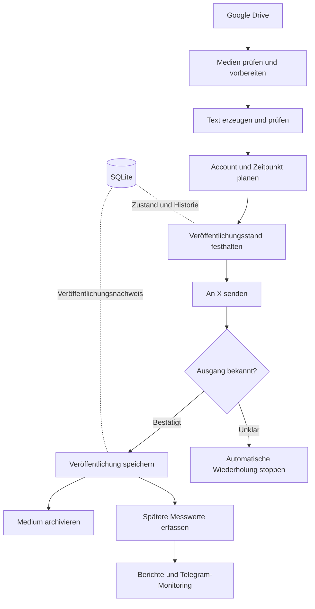

# So ist der Ablauf aufgebaut

[Übersicht](../README.de.md) · [English](ARCHITECTURE.md)

Die Anwendung trennt den Veröffentlichungsablauf von den Anbindungen an die einzelnen Anbieter. SQLite speichert die dauerhaften Zustände. Drive enthält die Medien; aus dem Ordner einer Datei wird nicht abgeleitet, ob sie bereits veröffentlicht wurde.

*Schematische Darstellung auf Grundlage des Projektberichts. Sie zeigt weder das genaue Datenbankschema noch einen Live-Systemzustand.*

## Medienvorbereitung

Die Bildverarbeitung unterstützt auch HEIC/HEIF. Bei Videos werden unter anderem Container, Codecs, Abmessungen und Dauer geprüft. Falls nötig, entsteht eine normalisierte Upload-Version. Die Originaldatei bleibt erhalten. Eine Inhaltsprüfsumme ordnet die abgeleitete Datei ihrer Quelle zu.

Die beschriebene Videoanalyse verwendet fünf über die Laufzeit verteilte Stichproben. Dadurch können Inhalte auffallen, die auf einem einzelnen Vorschaubild fehlen. Eine vollständige Prüfung jedes Frames ist das nicht. Unklare Bewertungen werden zur weiteren Prüfung zurückgehalten.

## Texte und Planung

OpenAI erzeugt Textvorschläge. Danach folgen regelbasierte Prüfungen des Texts, der Handlungsaufforderungen und der Ähnlichkeit zu früheren oder bereits reservierten Formulierungen. Ein abgelehnter Text gelangt nicht zur Veröffentlichung.

Zwei getrennte Account-Kontexte verwenden einen gemeinsamen Medienbestand und führen eigene Planungen und Veröffentlichungsnachweise. Die beschriebene Konfiguration sieht vier tägliche Bildslots je Account vor. Zwei zusätzliche Videoslots pro Account und Tag sind geplant; der Video-Zeitplan ist im bestätigten Stand noch deaktiviert. Diese Angaben beschreiben die Planung und keine gemessene Zustellquote.

## Zustände, Wiederaufnahme und parallele Prozesse

Vorbereitung, Freigabe, Veröffentlichungsversuch und bestätigte Veröffentlichung werden getrennt gespeichert. Der festgehaltene Veröffentlichungsstand verbindet den vorgesehenen Account mit Medium und Text. Eine unklare Antwort des Anbieters bleibt offen, bis sie geklärt werden kann.

Wartezeiten vor einem neuen Versuch überstehen Neustarts. Eine Prozesssperre verhindert gleichzeitig laufende Scheduler. Der Aktivierungszeitpunkt der Produktivplanung trennt ältere Testvorbereitungen von Inhalten, die für den Live-Zeitplan infrage kommen.

## Beobachtung und Betrieb

Telegram-Berichte fassen Anbieterzustände, Inhaltsreserven und Fehler bei der Vorbereitung zusammen. Technische Testposts bleiben von der geschäftlichen Auswertung getrennt. Messwerte, die ein Anbieter nicht liefert, werden als nicht verfügbar behandelt. Die Berichte verändern weder Postingstrategie noch Abrechnungslimits automatisch.

Der im Projektbericht beschriebene Deploymentablauf prüft den vorgesehenen Versionsstand, pausiert die Planung, sichert SQLite, führt Migrationen und gezielte Prüfungen aus und kontrolliert den Betrieb nach dem Neustart. Die Video-Erweiterung wurde mit weiterhin deaktivierter Veröffentlichung installiert. Dieses Repository beschreibt den Ablauf; es enthält keine Deploymentbefehle und bietet keinen Zugriff auf das laufende System.

[Entwicklungsprobleme](CASE-STUDY.de.md) · [Berichtete Ergebnisse und offene Arbeiten](STATUS.de.md)
