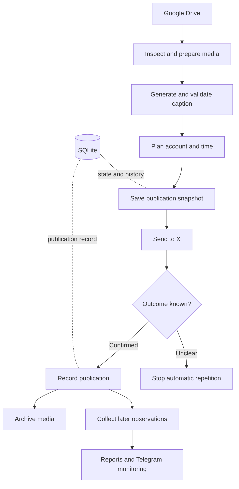

# How the workflow is put together

[Overview](../README.md) · [Deutsch](ARCHITECTURE.de.md)

The application separates the publishing workflow from the code that talks to each provider. SQLite holds the durable state. Drive stores media; its folder structure is not the authority on whether a post has already been published.

*Conceptual workflow based on the project report. This is not an exact database schema or a live system view.*

## Media preparation

Image handling includes HEIC/HEIF support. The video path inspects the container, codecs, dimensions and duration, then creates a normalized upload version when needed. Original files remain intact. A content hash connects each derivative to its source.

For video analysis, the described implementation samples five points across the duration. Those samples can reveal content missed by a single thumbnail, but cannot establish the suitability of every frame. Uncertain review results are held for further attention.

## Captions and planning

OpenAI generates captions. Deterministic checks then evaluate the text, calls to action and similarity to prior or reserved wording. A rejected caption does not proceed to publication.

Two account contexts share a media pool while retaining their own plans and publication records. The reported configuration uses four daily image slots per account. Two additional daily video slots per account are planned, but video scheduling is disabled at the confirmed project stage. These are configuration and planning details, not a measured delivery rate.

## State, recovery and concurrency

Preparation, readiness, attempted publication and confirmed publication are stored as separate stages. A saved publication snapshot binds the intended account, media and caption. An uncertain provider response remains unresolved until it can be checked.

Retry times survive restarts. A process lock prevents concurrent scheduler instances. The activation time of the production scheduler separates older test preparations from work eligible for the live schedule.

## Observation and operation

Telegram reports summarize provider health, content reserves and preparation failures. Analytics separate technical test posts from business results. Missing provider metrics stay unavailable rather than being replaced with an estimate. Reporting does not automatically change posting strategy or billing limits.

The deployment process described in the report checks the reviewed revision, pauses scheduling, backs up SQLite, applies migrations, runs focused checks and then checks operation after restart. The video extension was installed with publication still disabled. These procedures describe the project; this repository does not provide deployment commands or access to its runtime.

[Development problems](CASE-STUDY.md) · [Reported results and unfinished work](STATUS.md)
